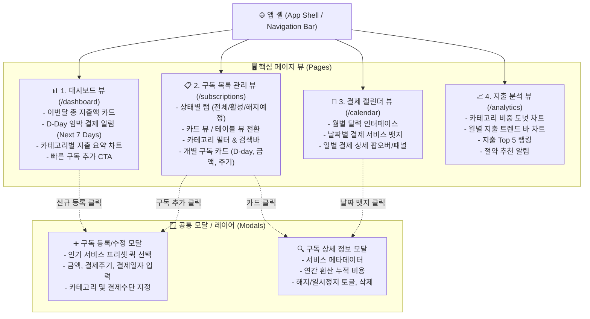
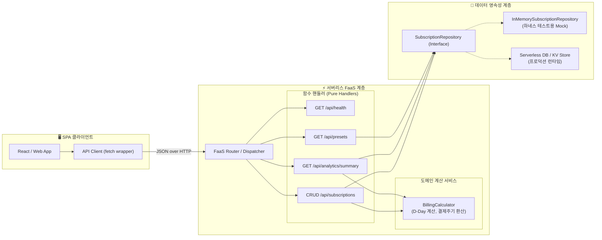

# 🏛️ ARCHITECTURE.md: 구독 서비스 관리 웹 (SubTrack) 시스템 아키텍처

## 1. 전체 페이지 구조 및 화면 흐름도 (Page Structure & Flow)

SubTrack은 SPA(Single Page Application) 기반의 반응형 웹으로, 사용자가 직관적으로 이동할 수 있는 4대 메인 뷰와 모달 시스템으로 구성됩니다.



---

## 2. 프론트엔드 컴포넌트 계층 구조 (Component Hierarchy)

```text
src/client/
├── components/
│   ├── layout/
│   │   ├── Header.tsx              # 상단 헤더 (로고, 빠른 등록 버튼, 프로필)
│   │   ├── Navigation.tsx          # 탭 네비게이션 (대시보드 / 목록 / 캘린더 / 분석)
│   │   └── Container.tsx           # 반응형 중앙 정렬 컨테이너
│   ├── dashboard/
│   │   ├── MetricCard.tsx          # 주요 지표 카드 (이번달 지출, 연간 환산, 활성 구독 수)
│   │   ├── UpcomingBills.tsx       # D-Day 임박 결제 리스트 위젯
│   │   └── SpendingSummary.tsx     # 카테고리별 지출 미니 차트
│   ├── subscriptions/
│   │   ├── SubscriptionCard.tsx    # 개별 구독 정보 카드 (로고, 금액, 결제일, 상태)
│   │   ├── SubscriptionList.tsx    # 그리드/리스트 컨테이너
│   │   ├── SubscriptionFilter.tsx  # 검색, 카테고리 필터, 정렬 드롭다운
│   │   └── SubscriptionModal.tsx   # 신규 등록 / 정보 수정 폼 모달
│   ├── calendar/
│   │   ├── MonthlyCalendar.tsx     # 월간 캘린더 그리드
│   │   └── DayCell.tsx             # 일자별 셀 및 결제 뱃지
│   ├── analytics/
│   │   ├── CategoryChart.tsx       # 카테고리 비중 차트
│   │   └── SpendingInsights.tsx    # 지출 분석 인사이트 카드
│   └── common/
│       ├── Badge.tsx               # D-Day 및 카테고리 뱃지
│       ├── Button.tsx              # 공통 버튼 컴포넌트
│       └── EmptyState.tsx          # 데이터 없을 때의 안내 UI
├── hooks/
│   ├── useSubscriptions.ts         # 구독 데이터 CRUD 및 캐시 제어
│   └── useAnalytics.ts             # 결제일 계산 및 통계 집계 로직
└── App.tsx                         # 뷰 라우팅 및 전역 상태 주입
```

---

## 3. 서버리스 백엔드 시스템 아키텍처



---

## 4. 데이터 모델 명세서 (Data Schema)

### 4.1. 구독 도메인 엔티티 (`Subscription`)
```typescript
export type BillingCycle = 'MONTHLY' | 'YEARLY' | 'WEEKLY';
export type SubscriptionStatus = 'ACTIVE' | 'PAUSED' | 'CANCELLED';
export type Category = 
  | 'ENTERTAINMENT' // 넷플릭스, 유튜브, 왓챠 등
  | 'PRODUCTIVITY'    // ChatGPT, Notion, GitHub, JetBrains 등
  | 'MUSIC'           // Spotify, 멜론, 애플뮤직 등
  | 'LIFESTYLE'       // 쿠팡 와우, 네이버 플러스, 컬리 등
  | 'EDUCATION'       // 강의, 도서, 학습 서비스
  | 'OTHER';          // 기타

export interface Subscription {
  id: string;                      // 고유 ID (UUID)
  name: string;                    // 서비스명 (예: "Netflix")
  cost: number;                    // 결제 금액 (예: 17000)
  currency: 'KRW' | 'USD';         // 통화 단위
  billingCycle: BillingCycle;      // 결제 주기
  billingDay: number;              // 결제일 (매월 1~31일)
  nextBillingDate: string;         // 다음 결제 예정일 (YYYY-MM-DD)
  category: Category;              // 카테고리
  paymentMethod?: string;          // 결제 수단 (예: "현대카드", "카카오페이")
  status: SubscriptionStatus;      // 활성 상태
  iconUrl?: string;                // 로고 아이콘 URL 또는 프리셋 키
  memo?: string;                   // 사용자 메모
  createdAt: string;               // ISO 8601
  updatedAt: string;               // ISO 8601
}
```

### 4.2. 통계 및 요약 응답 모델 (`AnalyticsSummary`)
```typescript
export interface AnalyticsSummary {
  monthlyTotal: number;            // 이번 달 총 지출 예상액 (KRW 기준)
  yearlyProjectedTotal: number;    // 1년 환산 총 지출액
  activeCount: number;             // 활성 구독 서비스 개수
  upcomingSubscriptions: Array<{  // 다가오는 7일 이내 결제 건
    subscription: Subscription;
    daysLeft: number;              // D-Day (0이면 오늘, 1이면 D-1)
  }>;
  categoryBreakdown: Record<Category, number>; // 카테고리별 합산 지출액
}
```

---

## 5. 서버리스 REST API 명세 (API Contract)

| 메서드 | 엔드포인트 | 설명 | 주요 파라미터 / 페이로드 |
| :--- | :--- | :--- | :--- |
| `GET` | `/api/health` | 서버리스 런타임 상태 진단 | - |
| `GET` | `/api/subscriptions` | 전체 구독 목록 조회 | 쿼리: `?status=ACTIVE&category=...` |
| `POST` | `/api/subscriptions` | 신규 구독 서비스 등록 | 본문: `SubscriptionInput` (Zod 검증) |
| `GET` | `/api/subscriptions/:id` | 단일 구독 정보 상세 조회 | 경로: `id` |
| `PUT` | `/api/subscriptions/:id` | 기존 구독 정보 수정 | 본문: 수정할 필드 |
| `DELETE`| `/api/subscriptions/:id` | 구독 항목 삭제 | 경로: `id` |
| `PATCH` | `/api/subscriptions/:id/status`| 활성/일시정지 상태 전환 | 본문: `{ status: "ACTIVE" \| "PAUSED" }` |
| `GET` | `/api/analytics/summary` | 대시보드 종합 지출 통계 | - |
| `GET` | `/api/presets` | 인기 구독 서비스 프리셋 목록 | - (넷플릭스, 스포티파이 등 메타 반환) |

---

## 6. 하네스(Harness) 검증 전략

- **날짜 및 D-Day 계산 결정론(Determinism)**:
  - 매월 28~31일 결제일 처리(윤달, 30일/31일 예외) 및 다음 결제일 계산 로직을 위해 테스트 환경에서는 `FakeClock`을 주입하여 테스트합니다.
- **통합 하네스 모킹**:
  - `InMemorySubscriptionRepository`를 통해 브라우저나 외부 DB 연결 없이도 모든 REST API 핸들러의 응답을 1초 이내에 100% 검증합니다.
