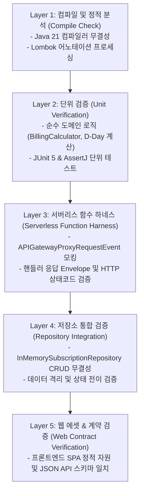

# 🛡️ HARNESS.md: Java 21 기반 테스트 & 검증 하네스 명세서

## 1. 하네스(Harness)의 목적과 철학

본 하네스는 AI 에이전트와 개발자가 코드를 생성하거나 수정한 후, **사람의 개입 없이 스스로 동작 여부를 100% 결정론적(Deterministic)으로 검증**할 수 있도록 구축된 통합 검증 환경입니다.

- **런타임 환경**: Java 21 (Temurin OpenJDK) & Maven & JUnit 5
- **웹 프론트엔드**: 경량 반응형 SPA (HTML5 / Modern ES6 / Tailwind / Chart)
- **서버리스 FaaS**: AWS Lambda Java 핸들러 (`RequestHandler<APIGatewayProxyRequestEvent, APIGatewayProxyResponseEvent>`)

---

## 2. 하네스 5단계 검증 계층 (Verification Layers)

---

## 3. 표준 하네스 실행 명령어 (Verification Commands)

루프 사이클 내에서 에이전트는 다음 단일 진입점 스크립트를 사용하여 단계별 검증을 수행합니다:

| 검증 단계 | 명령어 (PowerShell / CMD) | 소요 시간 | 설명 |
| :--- | :--- | :--- | :--- |
| **초고속 검증 (Fast)** | `.\harness.ps1 quick` | < 3초 | 핵심 단위 테스트 및 계산기 검증 |
| **단위/도메인 검증** | `.\harness.ps1 unit` | < 5초 | 도메인 모델 및 저장소 단위 테스트 |
| **서버리스 API 검증** | `.\harness.ps1 api` | < 8초 | 서버리스 람다 핸들러 입출력 계약 테스트 |
| **전체 하네스 통과 (Golden)** | `.\harness.ps1 verify` | < 15초 | **컴파일 및 모든 계층(L1~L5)을 순차 실행하는 최종 승인 커맨드** |

> *(참고: `mvn test` 명령어로도 전체 하네스가 완전히 동일하게 수행됩니다.)*

---

## 4. 로컬 서버리스 모킹 및 테스트 픽스처 규약

1. **APIGateway 이벤트 시뮬레이션**:
   - `tests/fixtures/` 또는 테스트 헬퍼 클래스를 통해 `APIGatewayProxyRequestEvent` 객체를 빌드하여 람다 핸들러에 주입합니다.
2. **시간 결정론 (Time Determinism)**:
   - D-Day 및 결제일 계산 테스트는 `java.time.Clock.fixed(Instant, ZoneId)`를 활용하여 언제 실행해도 결과가 동일하도록 고정합니다.
3. **무상태 인메모리 저장소**:
   - `InMemorySubscriptionRepository`를 활용하여 외부 DB 없이 초고속으로 메모리 상에서 독립 검증을 수행합니다.
