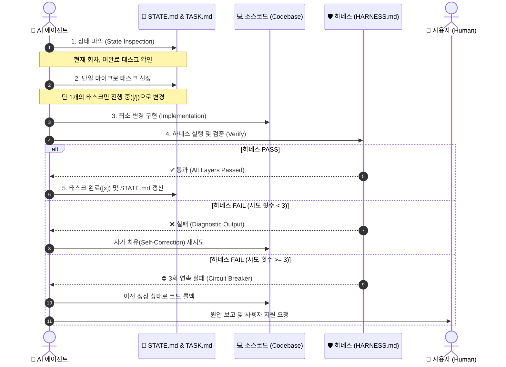

# 🔄 LOOP.md: 루프 엔지니어링 실행 프로토콜

## 1. 루프 엔지니어링(Loop Engineering)이란?

루프 엔지니어링은 AI 에이전트가 복잡한 소프트웨어 프로젝트를 수행할 때 발생하는 **환각(Hallucination), 컨텍스트 유실(Context Drift), 목표 이탈을 방지**하기 위해, 개발 전 과정을 **완전 자율 폐루프(Closed Feedback Loop)** 형태로 운영하는 엔지니어링 규약입니다.

---

## 2. 표준 5단계 루프 사이클 (Standard 5-Phase Cycle)

에이전트는 모든 작업 사이클마다 아래 5단계를 엄격히 순서대로 수행해야 합니다:

### [Phase 1] 상태 파악 (State Inspection)
- [`STATE.md`](./STATE.md)를 열어 현재 루프 카운트, 최근 성공 내역, 활성 이슈를 읽습니다.
- [`TASK.md`](./TASK.md)를 확인하여 프로젝트의 진행률과 미해결 항목을 스캔합니다.

### [Phase 2] 단일 마이크로 태스크 선정 (Micro-Task Selection)
- **규칙**: 반드시 **단 1개**의 가장 우선순위가 높은 태스크만 선택합니다. (한 번에 여러 작업 동시 진행 절대 금지)
- 선택된 태스크의 상태를 `[ ]`에서 `[/]` (진행 중)으로 변경합니다.
- 해당 태스크의 **완료 정의(DoD, Definition of Done)**와 **하네스 검증 커맨드**를 확인합니다.

### [Phase 3] 최소 변경 구현 (Focused Implementation)
- 선정된 태스크의 목표만을 달성하기 위한 가장 간결하고 명확한 코드를 작성/수정합니다.
- 불필요한 리팩터링, 다른 파일의 사전 수정, 스펙에 없는 임의 기능 추가를 엄격히 금지합니다.

### [Phase 4] 하네스 실행 및 자가 치유 (Harness Verification & Self-Correction)
- [`HARNESS.md`](./HARNESS.md)에 명시된 검증 커맨드(예: `npm run harness:verify`)를 실행합니다.
- **PASS**: 즉시 Phase 5로 이동합니다.
- **FAIL**: 출력된 진단 로그를 분석하여 자가 치유 루프를 수행합니다:
  - 에러 원인 식별 ➔ 코드 수정 ➔ 하네스 재실행
  - *동일 태스크에 대한 자가 치유는 최대 3회로 제한됩니다.*

### [Phase 5] 상태 영속화 및 진행 (State Persistence & Progression)
- [`TASK.md`](./TASK.md)에서 해당 태스크를 `[x]` (완료)로 갱신합니다.
- [`STATE.md`](./STATE.md)에 루프 번호 증가, 완료 요약, 남은 마이크로 태스크를 기록합니다.
- 필요한 경우 Git 커밋(`feat: [태스크명]` 등)을 생성합니다.

---

## 3. 서킷 브레이커 규약 (Circuit Breaker Policy)

무한 루프에 빠져 토큰을 낭비하거나 코드베이스를 망가뜨리는 현상을 원천 방지합니다.

| 조건 | 동작 (Action) |
| :--- | :--- |
| **단일 태스크 3회 연속 하네스 실패** | 1. 수정한 코드를 `git checkout` 또는 이전 정상 상태로 복구 2. [`STATE.md`](./STATE.md)에 블로커(Blocker)로 기록 3. 루프를 일시 중지하고 사용자에게 에러 로그 및 해결 방안 제시 |
| **컨텍스트 길이 초과 / 메모리 경고** | 1. 불필요한 중간 로그 정리 2. `/compact` 권장 및 핵심 상태만 [`STATE.md`](./STATE.md)에 요약 보존 |
| **기존 정상 테스트가 깨짐 (Regression)** | 1. 신규 작업을 즉시 중단 2. 회귀 원인 분석 및 원복 우선 수행 |

---

## 4. 에이전트 자율성 가이드 (Agent Guardrails)

1. **환각 패키지 방지**: 신규 라이브러리 추가 전 실제 공식 npm/Maven/Gradle 레지스트리에 존재하는지 검증해야 합니다.
2. **비파괴적 편집**: 기존의 주석, 다른 모듈의 동작 코드, 라이선스 파일 등을 임의로 삭제하지 않습니다.
3. **환경 분리 철저**: `.env` 시크릿 정보는 하드코딩하지 않고 모의 환경변수(`.env.example` / fixture)를 통해 주입합니다.
